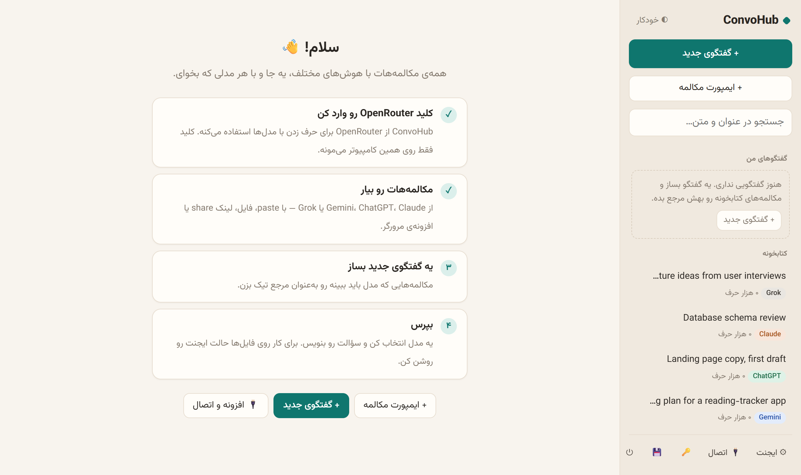

<div align="center">


# ConvoHub

**All your AI conversations in one local library — and continue any of them with any model.**

[](https://github.com/KayPraktor/ConvoHub/releases/latest)
[](https://github.com/KayPraktor/ConvoHub/releases)
[](LICENSE)
[](#limitations)

[](https://www.python.org)
[](https://fastapi.tiangolo.com)
[](https://www.sqlite.org)
[](https://modelcontextprotocol.io)
[](https://openrouter.ai)
[](#security-and-privacy)

[**Download**](https://github.com/KayPraktor/ConvoHub/releases/latest) · [Features](#features) · [Install](#install) · [Browser extension](#browser-extension) · [MCP](#connect-claude-code-and-other-tools-mcp) · [Privacy](#security-and-privacy)

</div>

<br>

<picture>
  <source media="(prefers-color-scheme: dark)" srcset="docs/images/home-dark.png">
  
</picture>

<br>

## Why

You think things through with Gemini, write with ChatGPT and code with Claude Code — and you end up carrying context between them by hand. ConvoHub removes you as the messenger:

- 📥 **Bring conversations in** from **Gemini, ChatGPT, Claude and Grok** into one library on your own computer.
- 💬 **Chat with any model** (through [OpenRouter](https://openrouter.ai)) and hand it earlier conversations as references: *"given these two chats, what's the next step?"*
- 🔌 **Share the library** with **Claude Code, OpenCode, Hermes and Cline** over MCP.

> [!NOTE]
> ConvoHub is a personal, local tool: no server, no account, no telemetry. The interface is in **Persian (right-to-left)**. Tested on **Windows 11** only.

## Features

| | |
|---|---|
| 📥 **Import** | Paste a chat page · official ChatGPT and Claude exports · `.txt` / `.md` files · public share links (Gemini, ChatGPT, Grok) · a **browser extension** that sends the open chat in one click and keeps it in sync |
| 📚 **Library** | Full-text search (Persian and English) · rename and delete · automatic summaries of long conversations to cut cost |
| 💬 **Chat** | Pick any OpenRouter model · tick the conversations to use as references · see the estimated tokens and cost before sending |
| 📤 **Handoff** | Take a chat you continued here back to the original Gemini/ChatGPT/Claude/Grok chat (only the new part), or on to another chatbot (with its background). Full text or a model-written brief · copy, `.md` file, or the extension puts it into the message box and you press Send |
| 🧠 **Memory** | Short notes about you and your work (role, projects, how you like answers) that every model sees, so you don't repeat yourself. Add them yourself, pull candidates from an imported conversation, or approve what a model suggests mid-chat; nothing is saved without you. On/off globally and per chat |
| 🧑‍⚖️ **Multi-model** | Ask several models at once, then let another model sum up where they agree and disagree |
| 🛠️ **Agent mode** | The model can browse and read files in folders you allow. Writing, running commands and deleting always ask you first |
| 🔌 **Integrations** | MCP server for Claude Code and others · your own MCP servers and skills inside agent mode |
| 💾 **Housekeeping** | Daily automatic backups · light, dark and auto themes |

## Install

### Option 1 — Installer (recommended)

No Python or other tools needed.

1. Download **`ConvoHub-Setup.exe`** (~55 MB) from the [latest release](https://github.com/KayPraktor/ConvoHub/releases/latest).
2. Run it. Windows will probably say **"Windows protected your PC"** — that's expected ([why?](#why-does-windows-warn-about-an-unknown-publisher)). Click **More info → Run anyway**.
3. Click through the wizard. It installs for your user only, needs no admin rights, and adds a desktop and Start-menu icon.
4. Open ConvoHub. It opens in your browser at `http://127.0.0.1:28765` and asks for your [OpenRouter key](#openrouter-key) first.

- **Update:** install the new `ConvoHub-Setup.exe` over the old one. Your library and settings stay.
- **Uninstall:** Settings → Apps → ConvoHub → Uninstall. It asks whether to delete your data too (library, backups, key); the default is *No*.

#### Why does Windows warn about an unknown publisher?

Windows warns about any program that isn't signed with a paid code-signing certificate. ConvoHub is a free, open-source project, so it isn't signed. The warning does not mean the program is harmful:

- All of the code is in this repository.
- The installer is built from this same code with [`packaging/build.ps1`](packaging/build.ps1).
- If you'd rather not run it, use Option 2 and run from source.

Some antivirus tools also flag programs built with PyInstaller by mistake.

### Option 2 — From source

The only prerequisite is **[uv](https://docs.astral.sh/uv/)**, which downloads the right Python by itself. Install it from PowerShell:

```powershell
powershell -ExecutionPolicy ByPass -c "irm https://astral.sh/uv/install.ps1 | iex"
```

Then:

1. Get the code — **Code → Download ZIP**, or:

   ```bash
   git clone https://github.com/KayPraktor/ConvoHub.git
   ```

2. Double-click **`install.bat`** in the project folder. It installs the packages and puts two shortcuts on your desktop: **ConvoHub** and a **Stop** shortcut.
3. Double-click the **ConvoHub** shortcut. (`start.bat` works too, but keeps a terminal window open.)

When run from source, data lives in the project's `data` folder. You can also put the key in a `.env` file instead of the UI (see [`.env.example`](.env.example)).

## OpenRouter key

ConvoHub talks to models through [OpenRouter](https://openrouter.ai): one account, hundreds of models (Gemini, Claude, GPT, DeepSeek, …).

1. Create an account on openrouter.ai and add a few dollars of credit. That lasts a long time — ConvoHub shows the estimated cost before every message.
2. Create a key under **Keys**. It starts with `sk-or-`.
3. ConvoHub asks for it on first start. You can change it later with the key button at the bottom of the sidebar.

## Browser extension

In ConvoHub, click **اتصال** (Connect) at the bottom of the sidebar. The page walks you through installing the extension in Chrome or Edge, with a button that opens the extension folder. In short:

1. Go to `chrome://extensions` (or `edge://extensions`).
2. Turn on **Developer mode**.
3. Click **Load unpacked** and pick the `extension` folder.
4. Open a chat page, then click **Accept** in ConvoHub to pair the extension.

Full guide (Persian): [docs/EXTENSION.md](docs/EXTENSION.md)

## Connect Claude Code and other tools (MCP)

In ConvoHub: **اتصال** (Connect) → **Claude Code و بقیه** (Claude Code and others). The ready-to-copy command for each tool already has the right paths for your machine. For Claude Code it looks like this:

```bash
claude mcp add convohub --scope user -- "%LOCALAPPDATA%\Programs\ConvoHub\convohub-mcp.exe"
```

Then ask Claude Code something like *"Read my advisor conversation from the ConvoHub library and tell me the next step."*

| Tool | What it does |
|---|---|
| `list_conversations` | List conversations, optionally by source |
| `search_conversations` | Search titles and text |
| `read_conversation` | Read the full text page by page, or just the summary |
| `add_conversation_text` | Add a conversation from text |
| `read_memory` | Your memory notes (read-only) |
| `add_conversation_from_link` | Import from a share link |

Full guide (Persian): [docs/MCP_SETUP.md](docs/MCP_SETUP.md)

## Security and privacy

- 🏠 **Everything stays local.**
  - The library, chats, settings and backups are stored only on your computer: in `%LOCALAPPDATA%\ConvoHub` for the installed app, or the `data` folder when run from source.
  - There is no central server, no account and no telemetry.
  - ConvoHub listens on `127.0.0.1` only, so other machines and websites can't reach it.
- 📤 **Conversations go only to the model you choose.** When you tick a conversation as a reference, its text (or summary) is sent with each message, through OpenRouter, to that model. So are your memory notes, while memory is on for that chat. OpenRouter's and the model provider's privacy policies apply, so think twice about very sensitive material.
- 🔑 **Your OpenRouter key** is stored only on this computer, encrypted with your Windows account (DPAPI). It is never included in backups and never shown in full in the UI.
- 🛠️ **Agent mode:**
  - Reading is limited to folders you allowed. Files such as `.env` and keys are never read.
  - Writing, editing, deleting (to the Recycle Bin) and running commands happen only after you click **Allow**.
  - MCP tools ask every time too, unless you chose "always allow" for a specific tool.

> [!WARNING]
> A command you approve in agent mode (PowerShell) is **not** limited to the allowed folders. It runs with your Windows account's full permissions on the **whole system**. Read the command before you approve it.

- 🧾 **Imported text is data, not instructions.** If a conversation or file says "do X", the model is told not to act on it, and nothing changes on your system without your approval anyway.
- 🧩 **The extension** reads only the text of the chat page you have open. It never reads or stores cookies, passwords or tokens, and ConvoHub accepts only the extension you paired.
- 🔗 **Share links** are visible to anyone who has them. Once imported, delete the link on the original site if you don't need it.

## Limitations

- **OS:** tested only on Windows 11 (64-bit).
- **Language:** the interface is in Persian (right-to-left). Conversations can be in any language.
- **Link import** needs Chrome or Microsoft Edge (Edge ships with Windows). Claude share links usually block automated browsers; for Claude, paste the text or use the extension.
- **Chat sites change their pages** from time to time. When that happens, the extension or link import may break until it's updated.
- **Network:** some chat sites, and OpenRouter itself, may be unreachable from some networks without a VPN.

## For developers

```bash
uv sync                      # install packages (including test tools)
uv run python -m convohub    # run
uv run pytest                # tests
powershell -ExecutionPolicy Bypass -File packaging\build.ps1   # build ConvoHub-Setup.exe (needs Inno Setup 6)
```

- **Architecture and key decisions (Persian):** [docs/DESIGN.md](docs/DESIGN.md)
- **Stack:** Python, FastAPI and SQLite, with a plain HTML/JS interface and no build step.

## License

[MIT](LICENSE). The bundled Vazirmatn font is under the [SIL Open Font License](convohub/static/fonts/OFL.txt).
